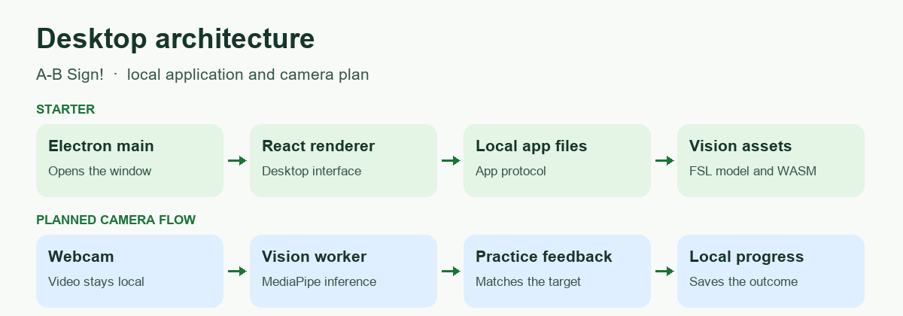
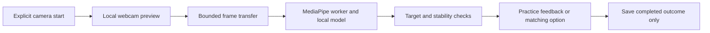
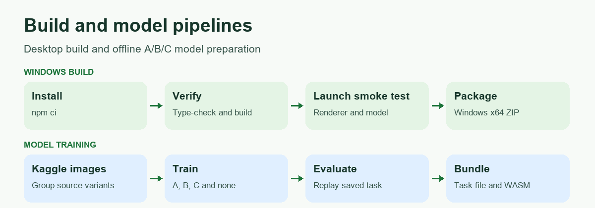

# A-B Sign! desktop implementation plan

## 1. Product scope

A-B Sign! is an offline teaching and practice app for instructors, student-teachers, and children learning Filipino Sign Language (FSL). Build a single desktop application with Electron, Node.js, React, TypeScript, and MediaPipe. Use the existing Stitch project as the design reference for all 18 desktop screens. The course flow includes demonstrations, guided practice, sign-matching assessments, activities, progress, and a local lesson and test builder.

**Desktop scope.** Build for offline use without accounts. The repository currently targets Windows x64. Before implementing onboarding and progress, confirm whether nickname and avatar are retained as device preferences and whether progress is shared by people using the same OS login. Before implementing the faculty builder, confirm how local lessons are made available from navigation and how to replace the prototype’s class assignment control.

The screen bodies show A-B-Sign! and SignSprout branding, placeholder content, and inconsistent links between mockups. Use A-B Sign! and FSL throughout. Apply the existing SignSprout design system to the desktop layouts, including its green and blue palette, Fredoka headings, Varela Round labels, large controls, and tactile button states. Replace hard-coded scores, camera matches, and progress with live state. An FSL-fluent Deaf educator should approve signs, permissible variants, demonstration videos, written cues, and quiz distractors before release. Start with the prototype's alphabet, numbers, greetings, family signs, and food and colors. Show a level or category as available when its approved lesson content is ready. Build out intermediate and advanced content from an approved syllabus and assets.

## 2. Get an FSL model into the app

**Train a custom FSL MediaPipe Gesture Recognizer outside Electron, then bundle its `.task` file and the matching MediaPipe WASM assets in the installer.** MediaPipe Model Maker takes labeled images, including a required `none` class, and exports a Gesture Recognizer task bundle. Electron's Chromium renderer runs the trained model with `@mediapipe/tasks-vision` in a Web Worker. The installed app only needs its local model assets and a webcam for inference. [Google training notebook](https://github.com/google-ai-edge/mediapipe-samples/blob/main/examples/customization/gesture_recognizer.ipynb) · [Gesture Recognizer for Web](https://developers.google.com/edge/mediapipe/solutions/vision/gesture_recognizer?tab=Web) · [MediaPipe task placement and threading](https://developers.google.com/edge/mediapipe/solutions/tasks#model_asset_placement_threading)

| Source | How it fits |
| --- | --- |
| [ji-chani/MediaPipe-FSL-Alphabet](https://github.com/ji-chani/MediaPipe-FSL-Alphabet/tree/main) | The closest technical reference. It uses 21 hand landmarks and a scikit-learn SVM for 24 static alphabet classes, excluding J and Z. The repository includes `.sav` artifacts and a scaler. These are Python artifacts. Obtain permission before reuse or redistribution. If reuse is authorized, evaluate the scaler and SVM together, export them together to a browser-compatible format such as ONNX, and check prediction parity on the same features. Use Model Maker for the planned shipping path. |
| [Porton FSL alphabet images](https://www.kaggle.com/datasets/japorton/fsl-dataset) and [DLSU in-the-wild FSL alphabet images](https://campol-russel.github.io/In-the-wild-FSL/) | Candidate static-letter benchmarks. The Porton images include neighboring frames from source videos, so random image splitting can leak near duplicates. The DLSU project describes an access request. Check provenance, access, and permitted uses before training or redistribution. [Porton dataset methodology](https://pmc.ncbi.nlm.nih.gov/articles/PMC11888903/) |
| [FSL-105 v2](https://data.mendeley.com/datasets/compare/48y2y99mb9) | The publisher lists 2,130 clips across 105 FSL signs and CC BY 4.0 for v2. Check actual label overlap with the curriculum, record attribution, and verify intended uses. Use video sequences for motion classes, supplementing with classroom-like footage from consenting adult signers where needed. |
| [WLASL](https://github.com/dxli94/WLASL) | Word-level American Sign Language. Use the paper or repository as a research reference for temporal recognition. Keep the app's training targets FSL. The dataset authors restrict their data to academic and computational use. |

### Steps to produce the first bundle

1. **Define the sign catalog.** Give every taught sign a stable ID, FSL label and gloss, approved video and cues, accepted variants, and a camera capability of `static`, `temporal`, or `unavailable`. Confirm the initial labels A, B, and C with the educator. Mark each candidate class with its evidence and rights status. The catalog controls what a lesson may ask the camera to score.
2. **Gather and split examples.** Start with consented adult demonstrations of A, B, and C, varied across signers, hands, cameras, lighting, distance, and backgrounds. Include `none` examples with detected hands, such as resting hands, transitions, and unrelated gestures. Split by signer before extracting or augmenting frames. Where signer metadata is missing, group by source clip or capture session and reserve a separate known-signer holdout with signers absent from training. Track unusable training frames and evaluate clips with no detected hands separately. Record the license or consent for training, model distribution, and teaching media as applicable.
3. **Train and export.** Use Google's Model Maker notebook as the starting point in a pinned Python environment on the training machine. Create separate train, validation, and test directories from the predefined signer groups, each with the same label folders including `none`. Augment training images only. Load each split with `Dataset.from_folder`, verify label order, train with `GestureRecognizer.create`, evaluate, and call `export_model` to produce `gesture_recognizer.task`. Preserve dataset revisions, split membership, code and dependency versions, evaluation results, and asset hashes. Keep raw training data outside the app and its source repository. See [model research and source notes](MODEL_RESEARCH.md).
4. **Package one versioned model.** Bundle the exported `.task`, WASM JS loaders and binaries from the exact `@mediapipe/tasks-vision` release, and a manifest with model version, runtime version, file hashes, classifier label-to-sign mapping, per-label thresholds, and stability rules. Load via `FilesetResolver.forVisionTasks` and `GestureRecognizer.createFromOptions` with app-local URLs and `runningMode: 'VIDEO'`. Map only known custom labels to sign IDs, suppress canned labels, and surface `none` and empty detection as separate states. Test the packaged files with networking disabled and a clean app profile. [MediaPipe JavaScript API](https://developers.google.com/edge/api/mediapipe/js/tasks-vision.gesturerecognizer) · [MediaPipe package and WASM resolver](https://developers.google.com/edge/api/mediapipe/js/tasks-vision)
5. **Expand one validated class at a time.** Add reviewed static letters and applicable numbers once they pass the same evaluation. Keep demonstrations and matching available for all approved lesson content from day one. For moving letters such as J and Z in the reference, and reviewed vocabulary that requires motion, two hands, or body location, add a separate sequence classifier. Use time series of both hands and, where the sign requires it, pose or face reference landmarks. Train on clips with consistent timing, landmark order, handedness conventions, and explicit missing-landmark masks. Evaluate wrong, incomplete, and unsegmented gestures. Export to ONNX and use local ONNX Runtime Web WASM when a sequence model is ready to ship. Route each practice prompt to its supported model and run the temporal model only when a supported task asks for it. [MediaPipe Hand Landmarker](https://developers.google.com/edge/mediapipe/solutions/vision/hand_landmarker?tab=Web) · [ONNX Runtime Web](https://onnxruntime.ai/docs/get-started/with-javascript/web.html)

**Model release gates.** Use per-class precision, recall, F1, and confusion matrices on held-out signers, plus wrong-sign and unknown false accepts in prompted webcam tasks. Report sample sizes, no-hand and timeout rates, working conditions, and end-to-end feedback delay. Initial pilot targets are macro-F1 of at least 0.85 across enabled classes, per-class precision and recall of at least 0.80, and at most 5% false accepts on wrong and unknown attempts, reported separately for each. Tune on validation data and freeze thresholds before final holdout tests. Repeat on the intended webcam hardware and run a supervised classroom usability trial under the school's approved procedure before relying on camera feedback for children. Keep a class in matching mode if coverage, rights, or demonstrated behavior falls short. Camera feedback is practice evidence and can be skipped without blocking a lesson.

## 3. Desktop architecture and content

| Part | Responsibilities |
| --- | --- |
| Electron main | Create the window, manage camera permission checks and requests, serve allowlisted bundle and imported media assets, handle file selection and validated imports, and own persistent state. Use a sandboxed renderer, context isolation, disabled Node integration, and narrow typed preload calls. Validate IPC payloads and sender. Deny unneeded permissions, external navigation, and popups. [Electron security](https://www.electronjs.org/docs/latest/tutorial/security) · [Electron session API](https://www.electronjs.org/docs/latest/api/session) |
| React renderer | Desktop shell, existing screens, lesson player, inline game views, video controls, keyboard interactions, and webcam preview. Use Vite for bundling, a local router, CSS design tokens, and bundled fonts and icons. Keep UI state in React and persist completed actions via preload. |
| Recognition worker | Run MediaPipe in a dedicated renderer Web Worker with one frame in flight, monotonic timestamps, and bounded sampling. Return sign IDs, scores, detection states, and landmarks only when the overlay needs them. Close transferred frames and inference resources promptly. |
| Content and storage | Read bundled, versioned curriculum JSON and packaged media. Store settings, lesson drafts and active revisions, imported media metadata, lesson checkpoints, quiz attempts, and award events in an app-local SQLite database via Node's `node:sqlite`, verified in the pinned Electron runtime during the packaging spike. Store approved imported video files alongside the database under the app data directory. [Node SQLite API](https://nodejs.org/api/sqlite.html) · [Electron app paths](https://www.electronjs.org/docs/latest/api/app#appgetpathname) |
| Packaging | Use Electron Forge to produce a Windows installer. Pin the Electron runtime, build tooling, lockfile, and model assets. Serve bundle resources via a secure, standard app protocol with same-origin fetch support. Route imported videos by stored media ID and support byte ranges for seeking. Serve correct JS, WASM, and media MIME types and set a restrictive content security policy compatible with WebAssembly and the worker. Exercise those settings in the installed binary. [Electron protocol API](https://www.electronjs.org/docs/latest/api/protocol) · [Forge Windows installer](https://www.electronforge.io/config/makers/squirrel.windows) |

**Code layout.** Use `src/main` and `src/preload` for desktop APIs, `src/renderer` for React and the vision worker, `src/shared` for IPC and content contracts, and `resources` for curriculum, video, model, and WASM assets. Keep reproducible training scripts under `model-training` and automated checks under `tests`. The installer includes the runtime outputs and approved assets.

**Content contract.** `Level` has ordered categories. `Category` has ordered lessons and prerequisite IDs. `Lesson` has a version and typed steps for `watchVideo`, `tapMatch`, `cameraSign`, and `wordSpell`. A `Sign` is a catalog entry referenced by lesson steps, video clips, and questions. A `MediaAsset` has a stable ID, source or attribution metadata, and an app-local playback URL. An `Attempt` stores lesson and revision IDs, result mode, verdict or quiz totals, timestamp, and model version where applicable. Use stable IDs across releases and preserve submitted attempts when lesson content changes. Version SQLite migrations and use one app instance to own writes. Validate references, unlock chains, camera label compatibility, and media at build time and before activating teacher lessons.

**Progress rules.** Finalize quiz submission, progress, and a unique milestone award in one transaction. A repeated submission for the same attempt ID returns its existing outcome. Score matching by correct answers divided by assigned questions. Adopt the prototype's 70% pass mark as a default configurable in lesson content. Keep camera practice outcomes as a distinct measure and store successful practice separately from quiz results. Display camera feedback in words such as “Hold steady,” “Try again,” or “Sign matched.” Compute any displayed camera success rate from completed practice attempts. Derive badges and unlocks from persisted events, and award a category badge once after its required lessons and category check are complete. Calculate daily goals from local calendar dates. Keep completion workable in matching mode.

**Video and authoring.** Bundle reviewed FSL examples with replay, pause, normal/slow speed, seek, captions where applicable, and readable signing cues. Use text and approved local audio or an installed offline voice for voice prompts. Import teacher videos through a file picker or drag-and-drop on the existing builder panel. Check file size and playback compatibility, copy to app-managed storage through a temporary file, and make the media reference available only after the copy succeeds. Preserve the previous video on a failed replacement. Support reorder, remove, autosaved draft, explicit save and activation, and preview with the same lesson components. A `cameraSign` step requires a supported catalog entry and a matching alternative. A `wordSpell` step checks a sequence of letter IDs and offers keyboard input. It can enable camera spelling when all constituent letters are supported, with a neutral or explicit confirmation between repeated letters.

## 4. Implement every Stitch screen

Route names are proposed. Keep camera, validation, error, and game states within these layouts. Use the actual curriculum and progress everywhere an existing mockup displays example counts or names.

| Existing Stitch screen | Route and behavior |
| --- | --- |
| Welcome | `/welcome`. First launch, sound preference, and start onboarding. Return visits resume the workspace after setup. |
| Profile Setup | `/setup/preferences`. Optional local nickname and avatar, with a default/skip action and no learner roster. |
| Initial Assessment | `/setup/assessment`. Two lightweight onboarding questions produce a level recommendation with a beginner default. The recommendation is advisory. |
| Camera Setup | `/setup/camera`. Explicit start, camera status and framing guidance, retry, and a direct route to continue without a camera. Reuse for dashboard camera checks. |
| Learner Dashboard | `/dashboard`. Resume last lesson step, link to learning path, recommended review, daily goal, and recent progress. Surface instructor access to the builder in the local shell. |
| Learning Path | `/path`. Show levels and category cards with computed progress, prerequisites, and actionable locked states. |
| Category Overview | `/category/:id`. List lessons with review/continue actions and the category assessment. Gate by prerequisites and enable a matching assessment for unsupported camera labels. |
| Lesson Overview | `/lesson/:id`. Show objectives, signs, estimated duration, previous attempts, and start or resume. |
| Sign Demonstration | `/lesson/:id/demo/:step`. Play the reviewed local clip, show its cues, support previous/next sign, replay, and slow playback. |
| Guided Practice | `/lesson/:id/practice/:step`. Pair demo and live preview, handle start/stop/retry, and offer matching when camera feedback is unavailable or skipped. |
| Assessment Quiz | `/lesson/:id/quiz` and category assessment mode. Use the same quiz engine for selections, previous/next, unanswered items, submission, and deterministic scoring. |
| Assessment Results | `/attempt/:id`. Show coherent totals, score, pass status, incorrect-item review, and retry. Direct to category celebration only when earned. |
| Category Celebration | `/category/:id/complete`. Show the persisted badge, completion summary, and next available category. |
| Match Lesson | `/match`. Reuse the video and answer components for Watch & Match, action feedback, replay, speed, and supported camera practice links. |
| Camera Gesture Recognition | `/camera`. Reuse camera practice for standalone or prompted signs, with hint, flip preview, reset, and tap mode. Remove the simulated-match control from the shipped UI. |
| Activities & Games | `/activities`. Memory Match pairs sign cards with glosses. Rapid Identification uses short demo clips and timed choices. Fingerspell Sprint uses letter-by-letter camera or keyboard input. Daily Quest selects five prompts from approved vocabulary available to the installation. Run all four inline, save scores, and award the daily quest bonus once per local date. |
| My Progress | `/progress`. Show derived course and category progress, recent attempts, earned badges, camera practice results, and review links. Offer a confirmed local progress reset without deleting authored lessons. |
| Faculty Lesson & Test Builder | `/builder`. Create, order, validate, preview, and locally activate video, matching, camera, and spelling steps. Replace mock class assignment with local availability. |

Check at 1280×1024 (prototype width and typical height), 1280×720 (shorter desktop viewport), and 150% Windows scaling. Use internal scrolling without hiding navigation or results. Provide keyboard-operable controls, focus restoration after route changes or dialogs, readable status text alongside color, and optional audio. Keep quiz and practice usable without sound.

## 5. Camera behavior

- Request video only from the trusted app window on an explicit action. Use the actual preview to show framing and hand-detection guidance. Map denied access, missing or busy camera, unplugging, missing model, and initialization failure to retry or matching within the existing layout. Stop all tracks, worker work, and pending feedback on stop, navigation, or window close. Ignore results from an earlier camera or prompt session.
- Sample at a proposed 10–15 frames per second and drop stale frames. Mirror the preview and overlay consistently while feeding the model the orientation used during training. Distinguish no hand, unknown gesture, a detected off-target sign, a candidate awaiting stability, and a confirmed match. Compare the top class against the requested target. Require validated score, margin where available, and time stability across frames before confirming. Require release or a new prompt before awarding another result. Keep camera matching and tap scoring independent so the fallback cannot appear as a verified camera match.
- Process live frames, landmarks, and confidence values in memory. Persist completed outcomes and their model version for progress. Restrict disk video to explicitly imported teaching assets. Keep model, UI, fonts, media, and inference dependencies local so classroom use works offline.

## 6. Build order and acceptance

| Phase | Work and exit condition |
| --- | --- |
| 0. Packaged feasibility and curriculum | Create the Electron/React/TypeScript shell and Windows test package. In parallel, confirm the pilot sign list and rights, acquire sample clips, and train an A/B/C-plus-`none` candidate. Prove that the actual packaged app loads a local `.task` and WASM in a worker with the network disabled, runs the webcam, shuts it off, seeks in a local video, and opens SQLite. A known webcam result is the technical feasibility gate. The classifier still needs the full quality gate. |
| 1. One complete teaching flow | Wire welcome, optional preferences, initial assessment, camera setup, dashboard, and one A/B/C lesson from demo through tap quiz and results. Reopen the app to verify checkpoints and totals. Check keyboard-only completion, denied camera, and one offline install. |
| 2. Curriculum and authoring | Add the remaining path, category, and lesson flows, unlocks, milestone and progress views, and the builder. Author and activate a local lesson, replace its video, run it through the shared player and quiz, then relaunch and verify the active revision and old attempt history. |
| 3. Camera practice and activities | Apply validated recognition to guided and free camera practice. Complete all four activities using the shared player and quiz components. Confirm loss of camera, uncertainty, repeated letters, unsupported signs, and low-confidence footage never award a false success from the application state machine. Exercise matching end to end from each fallback. Expand camera-backed vocabulary only as classes pass the model gates. |
| 4. Desktop release | Run the full suite against the installer on a clean Windows x64 machine and a representative school laptop. Check fresh install, restart, upgrade with old progress, teacher import, offline media seek, camera denial and unplugging, and recovery. Ship the installer, approved course assets, licenses and attributions, a teacher quick-start, and the model metric report. Sign distribution artifacts when a release signing certificate is available. |

### Verification checklist

- **Build and content.** Type-check, lint, run tests, and produce the installer from the lockfile. Validate all route and content references, prerequisite graph, media IDs, model file hashes, label coverage, and required attributions.
- **Automated behavior.** Cover quiz math, retries and idempotent award, migration from older state, goal rollover, lesson unlocks, failed media import and retained draft, recognition stability and stale messages, and camera-to-matching transitions. Use known model result fixtures for workflow tests and prerecorded approved clips for inference regression. Electron end-to-end automation can drive the installed UI, with physical webcam and Windows permission checks handled separately. [Playwright Electron support](https://playwright.dev/docs/api/class-electron)
- **Hardware and privacy.** With networking disabled, verify clean install, resource loading, video playback, camera start/stop and unplug, two available camera cases for switching if exposed, and offline quiz and builder paths. Inspect app data and network traffic during camera use for unexpected frame files, landmarks, or outbound calls. Benchmark a continuous 20-minute practice session with 640×480 capture. Initial targets are at least 10 processed frames per second, 100 ms or less p95 worker inference time, and feedback within one second of the stable gesture on the pilot laptop. Record observed metrics and verify the UI remains responsive during inference.
- **Curriculum and usability.** Check every demo, cue, and answer with the reviewing FSL educator. Complete onboarding, lessons, games, scoring, review, and teacher authoring with keyboard and mouse at the tested window sizes. Verify each route has meaningful states for empty content, unsupported gestures, and missing hardware where applicable.

**Release dependency.** App development can proceed with approved video and matching while the FSL model is trained and evaluated. Release camera scoring for each sign once the sign catalog, asset rights, Windows packaging, and held-out quality checks are satisfied. The initial installer can teach reviewed motion signs through playback and matching. Camera scoring for those signs follows validation of the temporal model.
