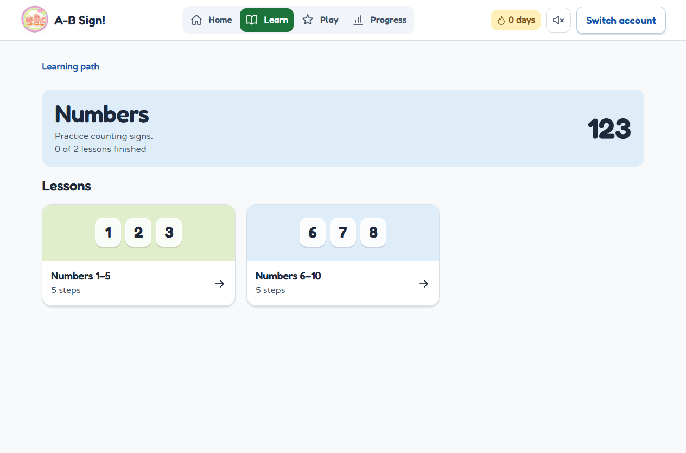
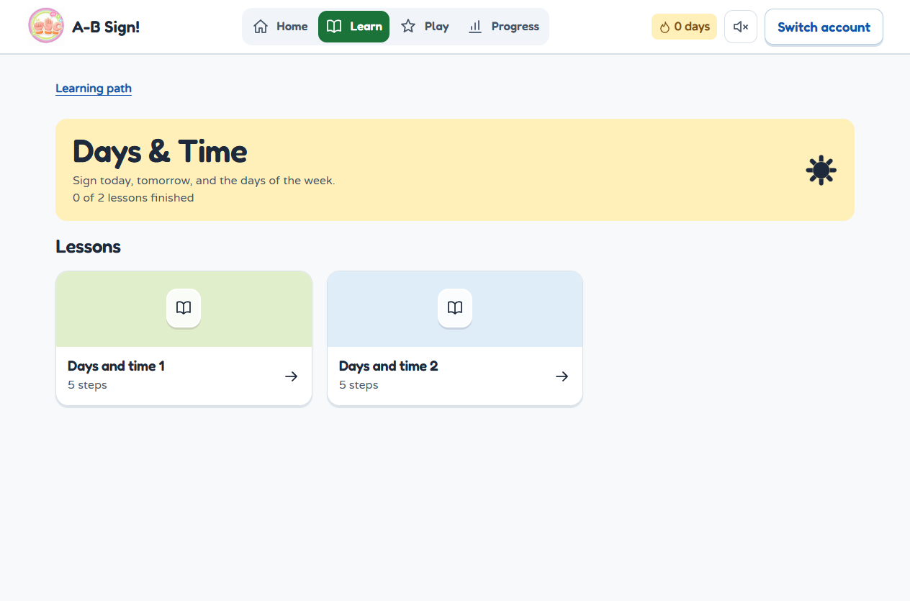

<p align="center">
  
</p>

# A-B Sign!

A Windows desktop app for teaching children Filipino Sign Language (FSL) through video demonstrations, sign-matching quizzes, and webcam practice. Accounts, lessons, and progress stay on the device.


[Quick start](#quick-start) · [Architecture](docs/ARCHITECTURE.md) · [Model results](#model-results) · [Implementation plan](IMPLEMENTATION_PLAN.md) · [Issues](https://github.com/izdewww/AB-Sign/issues)

## Project status

**Learn** includes nine editable alphabet lessons with one dataset photo per letter. Lessons group three letters at a time, with Y and Z in the last lesson. Learners can open any lesson and take its optional quiz.

The app also includes **21 editable video lessons** covering numbers 1–10 and 95 words and phrases. Learners can watch a sign, replay it slowly, and try a shuffled matching quiz.


## Local accounts

- **Students** add a name or choose it from the list. Each student keeps their own lesson progress, quiz results, and badges.
- **Teachers** select **Teacher sign-in**. The built-in account starts with the password `TeacherStart24!`. Replace it at first sign-in. To change it again, open **Account** and enter the current and new passwords.
- Open **Students** to view progress, edit a name, or remove an account and its progress. The app asks before removing an account.
- Progress from older versions was shared and stays separate from the new student accounts.

## For teachers

1. Open **Lessons** and create a blank lesson or edit a bundled lesson. Use **Hide alphabet lessons** to hide the letter lessons.
2. Add signs, replace pictures, and upload optional MP4 or WebM videos. The alphabet lessons start with empty video slots. Add a fingerspelling step to reveal a word one sign at a time.
3. Add a quiz if you want one. Choose the signs, question types, and number of questions. Each round shuffles the questions and answer choices using signs from that lesson.
4. Preview your work and select **Use on this device** when it is ready for learners.

Picture matching covers A–Z. Webcam practice covers 24 letters. J and Z are available in lessons and picture quizzes, and teachers can upload videos to show the movement.

### Numbers and words

| Activity | What’s available |
| --- | --- |
| Video demonstrations and matching | Numbers 1–10, Greetings, Family, Food & Colors, Words, Days & Time, Calendar, People, and Drinks & Flavors |
| Webcam practice | Numbers 1, 3, 5, 9, and 10, plus 43 words in published video lessons |
| Teacher drafts | Numbers 11–20 and 12 Everyday Errands signs. Add pictures or videos and publish when ready. Seven of the errands signs also support camera practice once published. |

Bundled quizzes start with matching. Teachers can add camera questions for supported signs. To check an individual sign, look for **Try this sign** on its lesson step. For a full list, see the [lesson catalog](src/renderer/vocabulary.json).





## Quick start

Use Windows x64 with Node.js 24 and npm. Run these commands from the repository root.

```powershell
npm ci
npm start
```

| Command | What it does |
| --- | --- |
| `npm run check` | Type-checks the desktop and React code |
| `node --test scripts/test-quiz.mjs` | Checks question and answer randomization |
| `npm run build` | Compiles the app and copies local model and WASM assets |
| `npm run smoke` | Checks account permissions and persistence, student progress, lessons, quizzes, and synthetic camera recognition in Electron |
| `npm run make` | Builds a Windows x64 ZIP under `out/make/` |

The [Windows workflow](.github/workflows/desktop.yml) runs these checks and attaches the ZIP to successful runs. [GitHub Actions](https://github.com/izdewww/AB-Sign/actions/workflows/desktop.yml)

## Architecture


[Desktop components and build pipeline](docs/ARCHITECTURE.md) · [Screen and feature inventory](IMPLEMENTATION_PLAN.md#desktop-screens)

## Model results

The bundled **v3 model** got **1,679 of 1,770 held-out photos correct (94.86%)** across the 24 camera letters, up from 91.13% for v2 on the same photos. V3 reached 90% on 19 letters. M, N, R, U, and Y remain below 90%. Classroom webcam accuracy on independent signers remains unverified. [Training guide](model-training/README.md) · [v3 evaluation](model-training/artifacts/fsl-geometry-v3-benchmark.json) · [v2 evaluation](model-training/artifacts/fsl-az-v2.json)


The bundled **word model** was trained on 107 words and phrases. Fifty met the 90% precision and recall cutoff on 603 test recordings, including seven Everyday Errands signs. On the 426 FSL-105 test clips alone, 42 words met the cutoff, down from 54 for the earlier FSL-105-only candidate. The **number model** uses a separate set of weights and supports the same five numbers. The splits have no signer IDs, so classroom webcam accuracy with new signers remains unverified. [Word benchmark](model-training/artifacts/fsl-words-v3-benchmark.json) · [Number benchmark](model-training/artifacts/fsl-vocabulary-v1-benchmark.json) · [Training guide](model-training/README.md)

## Credits

The alphabet uses John Gabriel Porton’s FSL alphabet dataset. The lesson videos use Isaiah Jassen Tupal’s FSL-105 dataset. The word model also uses Transactional FSL landmarks by Franz Columna and Angela Cardano. [Alphabet dataset](https://www.kaggle.com/datasets/japorton/fsl-dataset) · [FSL-105](https://data.mendeley.com/datasets/48y2y99mb9/2) · [Transactional FSL](https://data.mendeley.com/datasets/jdyrr7cm4z/2) · [Third-party credits](docs/THIRD_PARTY.md)
