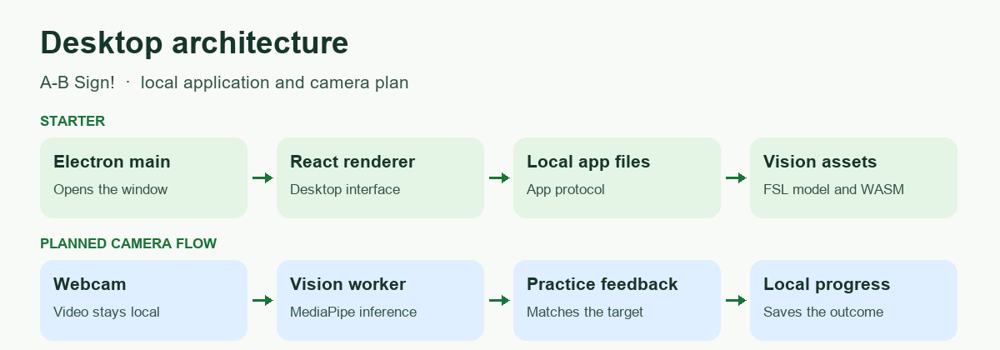
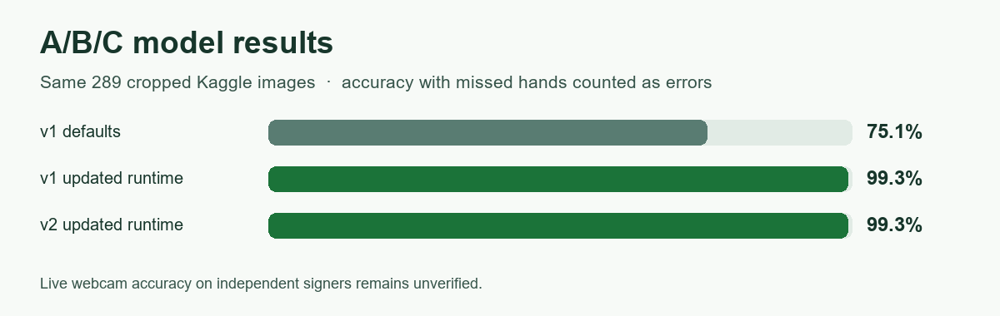

<p align="center">
  
</p>

# A-B Sign!

A desktop app in development for teaching children Filipino Sign Language (FSL) through video demonstrations, sign-matching quizzes, and webcam practice. It is designed for instructors and student-teachers to use offline, without accounts.


[Quick start](#quick-start) · [Architecture](docs/ARCHITECTURE.md) · [Model results](#model-results) · [Implementation plan](IMPLEMENTATION_PLAN.md) · [Issues](https://github.com/izdewww/AB-Sign/issues)

## Project status

The repository includes a runnable desktop starter, local model assets, reproducible training scripts, and a Windows build workflow. The lesson player, faculty builder, progress storage, and webcam scoring are implementation milestones in the [plan](IMPLEMENTATION_PLAN.md).

## Quick start

Use Windows x64 with Node.js 24 and npm. Run these commands from the repository root.

```powershell
npm ci
npm start
```

| Command | What it does |
| --- | --- |
| `npm run check` | Type-checks the desktop and React code |
| `npm run build` | Compiles the starter and copies local model and WASM assets |
| `npm run smoke` | Opens the built renderer in Electron and checks access to the model file |
| `npm run make` | Builds a Windows x64 ZIP under `out/make/` |

The [Windows workflow](.github/workflows/desktop.yml) runs these checks and attaches the ZIP to successful runs. [GitHub Actions](https://github.com/izdewww/AB-Sign/actions/workflows/desktop.yml)

## Architecture



[Desktop components and build pipeline](docs/ARCHITECTURE.md) · [Screen and feature inventory](IMPLEMENTATION_PLAN.md#4-implement-every-stitch-screen)

## Model results



The starter bundles the original A/B/C model. Padding the input and adjusting hand detection yielded **287/289 correct** on the reused Kaggle test split. Live webcam accuracy on independent signers remains unverified. [Runtime settings and training](model-training/README.md) · [Evaluation results](model-training/artifacts/fsl-abc-v2.json) · [Dataset sources](MODEL_RESEARCH.md)

## Credits

The A/B/C model was trained using [John Gabriel Porton’s FSL alphabet dataset](https://www.kaggle.com/datasets/japorton/fsl-dataset), listed as CC0. See [third-party credits](docs/THIRD_PARTY.md) for the model components and dependencies.
