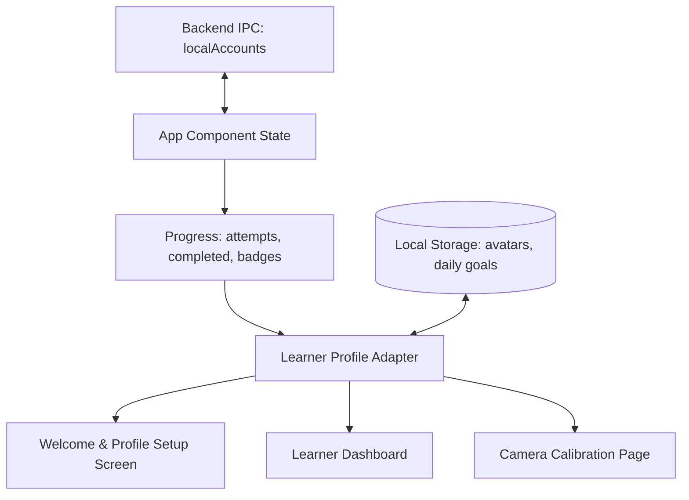

# A-B Sign! – UI/UX & Front-End Implementation Plan

**Scope:** Dedicated front-end UI/UX architecture and implementation.  
**Constraint:** Purely client-side/presentation layer (`src/renderer/`). **Zero modifications** to the existing backend (`src/main/` Electron IPC handlers, SQLite/file storage, or main process).

---

## 1. Executive Summary & Design System

This plan outlines the implementation of a modern, playful, child-friendly educational interface for **A-B Sign!**, inspired by contemporary gamified learning platforms (such as Duolingo and Khan Academy Kids).

### Design Foundations & Tokens

```css
:root {
  /* Core Palettes */
  --bg-app: #f8fafc;
  --bg-welcome: linear-gradient(145deg, #e0f2fe 0%, #f3e8ff 50%, #ffffff 100%);
  --navy-primary: #0f172a;
  --navy-secondary: #334155;
  --text-muted: #64748b;

  /* Brand & Accents */
  --accent-green: #16a34a;
  --accent-green-hover: #15803d;
  --accent-green-dark: #14532d;
  --accent-green-soft: #dcfce7;
  
  --accent-blue: #0284c7;
  --accent-blue-soft: #e0f2fe;
  --accent-purple: #9333ea;
  --accent-purple-soft: #f3e8ff;
  --accent-amber: #d97706;
  --accent-amber-soft: #fef3c7;
  --accent-rose: #e11d48;
  --accent-rose-soft: #ffe4e6;

  /* Surfaces & Radii */
  --radius-sm: 12px;
  --radius-md: 18px;
  --radius-lg: 24px;
  --radius-pill: 9999px;
  --shadow-subtle: 0 4px 12px -2px rgba(15, 23, 42, 0.05), 0 2px 6px -1px rgba(15, 23, 42, 0.03);
  --shadow-card: 0 10px 25px -5px rgba(15, 23, 42, 0.06), 0 8px 10px -6px rgba(15, 23, 42, 0.03);
  --shadow-elevated: 0 20px 30px -10px rgba(15, 23, 42, 0.1);
  --border-light: 1px solid #e2e8f0;
}
```

---

## 2. Architecture & File Inventory

All changes stay within `src/renderer/`. Existing backend IPC commands (`create`, `select`, `save-progress`, `state`) remain completely unaltered.

```
src/renderer/
├── assets/
│   └── avatars/                    # SVG / vector & image Buddy illustrations
├── avatars.tsx                      # Avatar definitions, metadata, palette tokens & icons
├── learner-profile.ts              # Client-side store & metadata adapter
├── welcome-page.tsx                 # Screen 1: Welcome & Profile Switcher/Creator
├── dashboard.tsx                    # Screen 2: Learner Dashboard (central learning space)
├── camera-setup-page.tsx            # Screen 3: Check Camera – Camera Calibration Page
├── camera.tsx                       # Live video capture, frame analysis & landmark stream
├── style.css                        # Modernized design tokens, layout & responsive rules
└── main.tsx                         # Router integration for welcome, dashboard & camera setup
```

---

## 3. Screen 1: Welcome & Learner Profile Setup Page

The first screen presented when opening the application or switching accounts (`#welcome`).

```
+-------------------------------------------------------------------------------+
|                             [ Logo: A-B Sign! ]                               |
|                     [ Badge: Account Switcher & Welcome ]                     |
|                           Welcome to A-B-Sign!                                |
|  Switch to your saved profile to continue your sign streak, or type a new name |
+---------------------------------------+---------------------------------------+
|  LEFT PANEL: Pick Your Profile        |  RIGHT PANEL: New Learner Setup       |
|  [Icon] 3 Learners Saved              |  [User+ Icon] Enter name & pick buddy  |
|                                       |                                       |
|  +---------------------------------+  |  Learner Name                         |
|  | [Avatar] Zoe           (Active) |  |  [ Type your name (e.g., Sam)   [✏️] ] |
|  | Level 2 • Alphabet              |  |                                       |
|  | 🔥 5-day streak • ⭐ 350 pts     |  |  Choose Avatar Buddy                  |
|  | [ CONTINUE ]                    |  |  +---------+ +---------+ +---------+  |
|  +---------------------------------+  |  | Sprout  | | Hoot    | | Leo     |  |
|  +---------------------------------+  |  | (Frog)  | | (Tiger) | | (Lion)  |  |
|  | [Avatar] Sam                    |  |  +---------+ +---------+ +---------+  |
|  | Level 1 • Greetings             |  |  +---------+ +---------+ +---------+  |
|  | 🔥 1-day streak • ⭐ 120 pts     |  |  | Sparky  | | Barnaby | | Pip     |  |
|  | [ SWITCH ]                      |  |  | (Fox)   | | (Bear)  | | (Rabbit)|  |
|  +---------------------------------+  |  +---------+ +---------+ +---------+  |
|                                       |                                       |
|  ℹ️ Stored locally on this device.    |  [ === CREATE & START === ]           |
+---------------------------------------+---------------------------------------+
|                     [ Teacher Sign-in Link (Discreet) ]                       |
+-------------------------------------------------------------------------------+
```

### 3.1. Welcome Header
- **Top Center Position:** Brand logo centered with soft drop-shadow.
- **Pill Badge:** `Account Switcher & Welcome` (Soft lavender background, dark purple text).
- **Heading:** `Welcome to A-B-Sign!` (Fredoka Variable, navy color, bold 2.8rem).
- **Supporting Text:** Friendly explanation to resume streak or create a fresh buddy.

### 3.2. Left Panel: Pick Your Profile
- **Header:** Learners icon, title `"Pick Your Profile"`, subtitle `"Tap your avatar to jump right in."`, counter badge indicating total saved learners.
- **Profile Cards:**
  - Learner Avatar with custom animal buddy illustration.
  - Learner name in bold typography.
  - Level badge (`Level X • Category Name`).
  - Streak indicator with flame icon (`X-day streak`).
  - Accumulated points (`X pts`).
  - Action button:
    - **`Continue`** (Accent green button) for the active profile.
    - **`Switch`** (Soft secondary button) for inactive profiles.
- **Local Persistence Notice:** Subtle footer callout explaining device-local persistence.

### 3.3. Right Panel: New Learner Setup
- **Header:** User-plus icon, title `"New Learner?"`, subtitle `"Enter name & pick a favorite buddy."`
- **Name Input:**
  - Clean floating card input with edit icon indicator.
  - Placeholder: `"Type your name (e.g., Sam, Zoe)"`.
  - Max length: 40 characters; auto-focus on load.
- **Avatar Buddy Picker Grid (2x3):**
  1. **Sprout (Frog):** Soft mint green card `#e1eecb`, forest green border on select.
  2. **Hoot (Tiger):** Warm apricot/orange card `#ffe4d8`, amber border on select.
  3. **Leo (Lion):** Golden sunshine card `#fff0ba`, gold border on select.
  4. **Sparky (Fox):** Coral card `#fed7aa`, terracotta border on select.
  5. **Barnaby (Bear):** Toffee/mocha card `#f5ebe0`, chocolate border on select.
  6. **Pip (Rabbit):** Lavender card `#f0e1f8`, purple border on select.
  - Active Selection: Bold 3px border, slight upward lift (`translateY(-3px)`), and a green circular checkmark badge.
- **Primary CTA Button:**
  - Full-width button: **`CREATE & START`**.
  - Validation: Displays inline warning if name is empty or no avatar is picked.
  - On submit:
    1. Triggers backend `act({ action: 'create', name }, 'home')`.
    2. Saves selected buddy avatar to local client storage.
    3. Seamlessly routes to `#home` (Learner Dashboard).

---

## 4. Screen 2: Learner Dashboard (`#home`)

The learner's central learning space after login or profile selection.

```
+-------------------------------------------------------------------------------+
|  WELCOME CARD (Full Width)                                                    |
|  [Avatar]  WELCOME BACK!                                    [ Check Camera ]  |
|            Hi, Zoe! Ready to sign?                                            |
|            Level 2 • You're on a roll! Keep up the great signing!             |
+---------------------------------------------+---------------------------------+
|  LEFT COLUMN (60% Width)                    |  RIGHT COLUMN (40% Width)       |
|                                             |                                 |
|  A. CONTINUE LEARNING (Dark Green Surface)  |  A. DAILY GOAL                  |
|  [UP NEXT] Lesson 3 of 8                    |  Target: 3 of 5 Signs Done      |
|  Letters & Signs C, D, E                    |  [==== Progress Bar 60% ====]   |
|  FSL Hand Shapes • 3 minutes left           |  Sign 2 more letters today to   |
|  [==== Progress Bar 35% ====]               |  keep your 5-day streak!        |
|  [ CONTINUING LESSON -> ]                   |                                 |
|                                             |  B. PROGRESS OVERVIEW           |
|  B. LEARNING PATH                           |  [View All Progress ->]         |
|  Step-by-step units [View Learning Path ->] |  +-------------+ +------------+ |
|  +---------------------------------------+  |  | 4 Lessons   | | 12 Signs   | |
|  | Unit 1 - The Alphabet   [IN PROGRESS] |  |  | Completed   | | Mastered   | |
|  | A to Z Letters • 6/9 Lessons Done     |  |  +-------------+ +------------+ |
|  +---------------------------------------+  |  Average Match Accuracy: 94%    |
|  | Unit 2 - Greetings      [NEXT]        |                                 |
|  | Hello, Salamat, Bye                   |  C. RECENT BADGES               |
|  +---------------------------------------+  |  [View Achievements ->]         |
|  | Unit 3 - Food & Colors  [LOCKED]      |  +----------------------------+ |
|  | Requires Unit 2 completion            |  | 🌿 First Sprout             | |
|  +---------------------------------------+  |  | 🏆 5-Day Halo               | |
|                                             |  | ⭐ Camera Star              | |
|  C. RECOMMENDED REVIEW                      |  +----------------------------+ |
|  Quick 1-min replay [Needs Practice Badge]  |                                 |
|  [Sign Illustration] Letter B - Flat Palm   |                                 |
|  Tip: Remember to keep your thumb tucked!   |                                 |
|  [ PRACTICE WITH CAMERA ]                   |                                 |
+---------------------------------------------+---------------------------------+
```

### 4.1. Welcome Header (Full-Width Banner)
- **Learner Avatar Display:** 80x80px circular frame with active animal buddy illustration and soft aura.
- **Top Label:** Small uppercase badge `"WELCOME BACK!"` with bright green spark icon.
- **Heading:** `"Hi, [Learner Name]! Ready to sign?"`.
- **Status Subtext:** Dynamic learner level & motivation message (e.g., `"Level 2 • You're on a roll! Keep up the great signing!"`).
- **Camera Action:** `"Check Camera"` button (`#camera-setup`) styled with camera icon and soft glassmorphism background.

### 4.2. Left Column: Core Learning & Active Recommendations
- **Continue Learning Card:** Dark green background (`#14532d` with emerald accents), `UP NEXT` pulse badge, lesson indicator, category details, completion percentage bar, and prominent `CONTINUE LESSON` CTA button.
- **Learning Path Summary:** Unit cards (`Unit 1: The Alphabet [IN PROGRESS]`, `Unit 2: Greetings [NEXT]`, `Unit 3: Food & Colors [LOCKED]`) with direct category links.
- **Recommended Review Card:** Displays a sign needing practice with a friendly coaching tip and `PRACTICE WITH CAMERA` CTA (`#camera/[sign]`).

### 4.3. Right Column: Goals, Statistics & Gamification
- **Daily Goal Card:** Dynamic progress bar tracking completed signs today against a 5-sign target with streak encouragement.
- **Progress Overview Card:** Two stat tiles (Lessons Completed, Signs Mastered) plus sign match accuracy percentage.
- **Recent Badges Card:** Gamified badge stack showcasing *First Sprout*, *5-Day Halo*, and *Camera Star*.

---

## 5. Screen 3: Check Camera – Camera Calibration Page (`#camera-setup`)

A dedicated calibration screen designed to verify camera access, room illumination, and hand placement prior to sign recognition activities.

```
+-------------------------------------------------------------------------------+
|                            Let's Check Your Camera                            |
|             [ 🔒 Your camera stays on your device. We do not save/share ]      |
+---------------------------------------------+---------------------------------+
|  LEFT PANEL: Camera Preview                 |  RIGHT PANEL: 3 Easy Tips       |
|                                             |                                 |
|  [● Camera Connected]    [☀️ Great Lighting] |  3 Easy Tips for Best Results   |
|  +---------------------------------------+  |                                 |
|  |                                       |  |  +----------------------------+ |
|  |            +-------------+            |  |  | ☀️ Tip 1 - Face the Light   | |
|  |            |   ( ✋ )    |            |  |  | Sit facing a lamp or window | |
|  |            |  Hold Hand  |            |  |  | so your hands are bright    | |
|  |            |    Here     |            |  |  | and easy to see.            | |
|  |            +-------------+            |  |  +----------------------------+ |
|  |             (Dashed Guide)            |  |                                 |
|  |                                       |  |  +----------------------------+ |
|  |  When we hold your hand inside the    |  |  | ✋ Tip 2 - Keep Hands in Front| |
|  |  green box...                         |  |  | Hold your hand at chest     | |
|  +---------------------------------------+  |  | level, about an arm's       | |
|                                             |  | distance from the screen.   | |
|  [ Readiness Feedback Banner: Camera Ready ] |  +----------------------------+ |
|                                             |                                 |
|  [ < Back to Dashboard ]   [ Continue > ]   |  +----------------------------+ |
|  [ 🔄 Retry Camera ]                         |  | ✅ Tip 3 - You Are Ready!   | |
|                                             |  | When the box glows green,   | |
|                                             |  | you can start signing!      | |
|                                             |  +----------------------------+ |
+---------------------------------------------+---------------------------------+
```

### 5.1. Page Header
- **Main Heading:** Top-center `Let's Check Your Camera` (Fredoka Variable, navy color, 2.5rem).
- **Privacy Assurance Badge:**
  - Pill badge with privacy lock/shield icon (`🔒` / `Icon name="lock"`).
  - Copy: `"Your camera stays on your device. We do not save or share your video."`
  - Reassures young learners and teachers that video feeds are processed entirely in memory by the local MediaPipe worker and never recorded or transmitted.

### 5.2. Camera Preview Panel (Left Column)
- **Live Video Viewport:**
  - 4:3 / 16:9 responsive video feed container with rounded corners (20px) and dark neutral surround.
  - Video tracks mirrored by default (`transform: scaleX(-1)`) for natural intuitive movement.
- **Status Indicators (Top Bar Overlay):**
  - **Connection Badge:**
    - Connected: Green dot `● Camera Connected`
    - Connecting/Denied: Orange/Red dot `● Camera Connecting...` / `● No Camera Found`
  - **Lighting Quality Badge:**
    - Adequate Lux: Green badge `☀️ Great Lighting`
    - Dim Lux: Amber badge `⚠️ Low Lighting (Move closer to light)`
- **Hand-Positioning Alignment Guide (Center Overlay):**
  - Rounded rectangular dashed bounding box centered in the viewport.
  - Inset hand silhouette illustration (`✋`) showing the ideal hand orientation.
  - Clear label: `"Hold Hand Here"`.
  - Supporting instruction at bottom: `"Hold your hand inside the guide box until it turns green."`
- **Dynamic Interaction & Landmark Detection:**
  - Integrates with MediaPipe Tasks Vision (or brightness/bounding check via canvas sampler).
  - When hand is detected inside bounds:
    - Dashed guide border turns **solid luminous green** (`#22c55e`) with glowing aura (`box-shadow: 0 0 20px rgba(34, 197, 94, 0.4)`).
    - Status changes from *Hand Not Detected* to *Hand Aligned*.

### 5.3. Easy Tips Section (Right Column)
- **Section Heading:** `"3 Easy Tips for Best Results"` (navy heading with light bulb / star icon).
- **Tip Card 1 – Face the Light:**
  - **Icon:** Radiant Sun icon (`☀️`) in warm yellow circle.
  - **Title:** `Face the Light`
  - **Description:** `"Sit facing a lamp or window so your hands are bright and easy to see."`
- **Tip Card 2 – Keep Hands in Front:**
  - **Icon:** Hand icon (`✋`) in mint green circle.
  - **Title:** `Keep Hands in Front`
  - **Description:** `"Hold your hand at chest level, about an arm's distance from the screen."`
- **Tip Card 3 – You Are Ready!:**
  - **Icon:** Check-circle icon (`✅`) in sky blue circle.
  - **Title:** `You Are Ready!`
  - **Description:** `"When the box glows green, you can start signing right away!"`

### 5.4. Camera Readiness Feedback System
The bottom status banner provides dynamic visual states:

| State | Color Tone | Icon | Banner Message & Action |
| :--- | :--- | :--- | :--- |
| **Camera Not Connected** | Red (`#ef4444`) | 🚫 | *"Camera access needed. Please allow camera permissions in your settings."* |
| **Camera Connected** | Sky (`#0284c7`) | 📷 | *"Camera connected! Looking for your hand..."* |
| **Poor Lighting** | Amber (`#f59e0b`) | 💡 | *"Lighting is a bit dark. Try facing a light or window."* |
| **Hand Not Detected** | Amber (`#f59e0b`) | ✋ | *"No hand detected yet. Hold your hand up in front of the screen."* |
| **Adjust Hand Position** | Orange (`#ea580c`)| ↔️ | *"Move your hand a little closer inside the green dashed box."* |
| **Camera Ready** | Green (`#16a34a`)| 🎉 | *"Awesome! Perfect lighting and position. You are ready to sign!"* |

### 5.5. Navigation and Control Actions
- **Back to Dashboard:** Secondary action link/button (`href="#home"`) to return without interruption.
- **Retry Camera:** Appears if permission was denied, device disconnected, or stream failed; re-invokes `navigator.mediaDevices.getUserMedia`.
- **Continue CTA:**
  - Large primary button: **`Continue to Practice`** (or **`Start Signing`**).
  - Becomes active and pulses once the camera conditions are validated.
  - Navigates to `#camera` (alphabet letter practice) or returns to the active lesson quiz (`#lesson/...`).
  - Preserves student progress and streak intact.

---

## 6. Client-Side Storage & Data Adapter Strategy

To guarantee **zero backend changes**, we use the strictly typed client adapter: `src/renderer/learner-profile.ts`.



---

## 7. Implementation Phases & Milestones

### Phase 1: Buddy Avatar Assets & Token Setup
- [x] Create 6 friendly vector buddy illustrations (`sprout`, `hoot`, `leo`, `sparky`, `barnaby`, `pip`) in `src/renderer/avatars.tsx`.
- [x] Integrate authentic artwork from `docs/images/` (`Frog.jfif`, `Tiger.png`, `Lion.jfif`, `Fox.png`, `Bear.png`, `Rabbit.png`).
- [x] Extend `src/renderer/style.css` with CSS custom properties for pastel gradients, soft cards, and buddy themes.

### Phase 2: Client Profile Adapter
- [x] Create `src/renderer/learner-profile.ts` with helper functions:
  - `getLearnerAvatar(studentId: string)`
  - `setLearnerAvatar(studentId: string, avatarId: string)`
  - `deriveLearnerStats(student, progress, library)`
  - `getDailyGoalProgress(attempts)`
  - `getRecommendedReview(attempts, library)`

### Phase 3: Screen 1 – Welcome & Learner Profile Setup
- [x] Create `src/renderer/welcome-page.tsx`.
- [x] Implement Left Panel (`Pick Your Profile`) displaying saved student cards, level, streak, and points.
- [x] Implement Right Panel (`New Learner Setup`) with name input, 2x3 avatar grid, and `CREATE & START` handler.
- [x] Validate form inputs and ensure single-page seamless navigation to Dashboard.

### Phase 4: Screen 2 – Learner Dashboard
- [x] Assemble `src/renderer/dashboard.tsx` with responsive two-column grid.
- [x] Implement full-width welcome banner with active avatar and `Check Camera` button.
- [x] Implement prominent dark green `Continue Learning` card with progress bar.
- [x] Implement `Learning Path`, `Recommended Review`, `Daily Goal`, `Progress Overview`, and `Recent Badges`.

### Phase 5: Screen 3 – Camera Calibration Page (`#camera-setup`)
- [ ] Create `src/renderer/camera-setup-page.tsx`.
- [ ] Implement Page Header with privacy badge (`"Your camera stays on your device"`).
- [ ] Implement Camera Preview Panel with live feed, connection status, lighting analyzer, and central hand guide box.
- [ ] Implement hand detection visual state feedback (box glows green when hand is aligned).
- [ ] Implement `3 Easy Tips for Best Results` side panel with custom illustrations.
- [ ] Implement dynamic readiness feedback banner and navigation actions (`Back to Dashboard`, `Retry Camera`, `Continue to Practice`).
- [ ] Connect `#camera-setup` route in `src/renderer/main.tsx`.

### Phase 6: Styling, Accessibility & Verification
- [ ] Add Camera Calibration styles to `src/renderer/style.css`.
- [ ] Full keyboard navigation (`Tab`, `Enter`, `Space`) and screen-reader aria live regions.
- [ ] Responsive testing across 1280x900 desktop and smaller 768px viewports.
- [ ] Run `npm run check` and `npm run build` to verify type safety and asset compilation.

---

## 8. Verification & Acceptance Criteria

| Area | Acceptance Criteria |
| :--- | :--- |
| **Backend Integrity** | No edits made to `src/main/` or IPC contracts. Existing databases and accounts load without errors. |
| **Welcome Page** | Shows saved profiles with avatars, names, levels, streaks, and points. Name entry and 6-buddy grid create profiles. |
| **Learner Dashboard** | Displays active buddy avatar, greeting, dark green continue card, learning path, daily goal, and badges. |
| **Camera Privacy Badge** | Prominently displays privacy reassurance badge explaining video never leaves the device. |
| **Live Camera Feed** | Prompts for permission, connects to device camera, handles camera disconnect/denial gracefully. |
| **Hand Guide & Lighting** | Dashed hand silhouette guide in viewport center; turns solid green with glowing effect when hand is detected; monitors illumination. |
| **3 Easy Tips** | Clean 3-card stack on the right explaining lighting, hand position, and green ready state. |
| **Readiness States** | Accurately distinguishes *Camera Not Connected*, *Poor Lighting*, *Hand Not Detected*, *Adjust Position*, and *Camera Ready*. |
| **Navigation Actions** | `Back to Dashboard` returns safely; `Retry Camera` re-requests feed; `Continue` proceeds to practice when ready. |
| **Build & Type Check** | `npm run check` passes with 0 TypeScript errors; `npm run build` packages without errors. |
