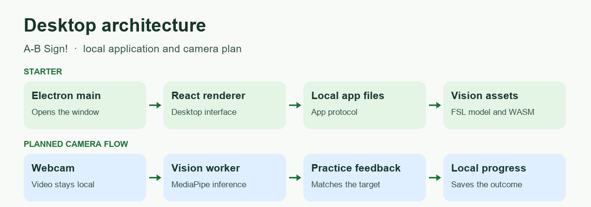
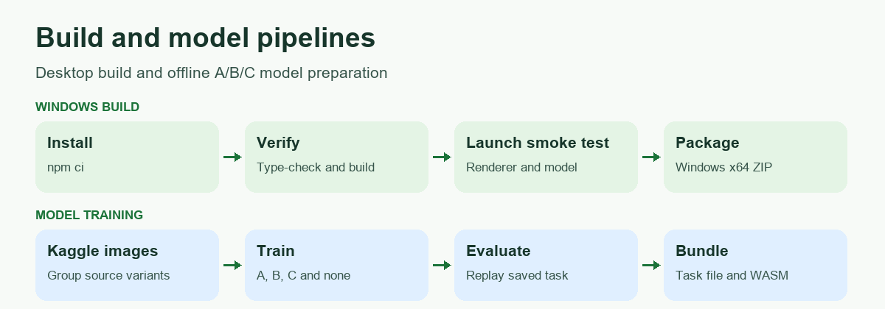
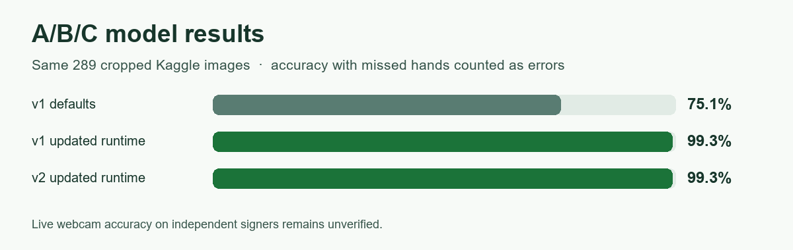

# Architecture and pipelines

[README](../README.md) · [Implementation plan](../IMPLEMENTATION_PLAN.md) · [Training guide](../model-training/README.md)

| Location | Responsibility |
| --- | --- |
| `src/main/` | Electron lifecycle, window, local asset protocol, and permission defaults |
| `src/renderer/` | React desktop starter and styling |
| `scripts/` | Model checksum verification and local build asset preparation |
| `model-training/` | Dataset preparation, training, and benchmark reports |
| `.github/workflows/` | Windows verification and ZIP build |
| `docs/` | Architecture, results, images, and credits |

## Build and training

The build verifies the selected model’s checksum and copies the model and MediaPipe WASM files into the local renderer output. `npm run smoke` checks that Electron can load the renderer and read the model file.

Training is a separate development task. Follow the [training guide](../model-training/README.md) for the dataset, Python environment, and export commands.

The [implementation plan](../IMPLEMENTATION_PLAN.md) tracks the 18 prototype screens, lesson content, local progress, camera behavior, and release checks. Classroom validation requires full webcam frames from independent signers.
